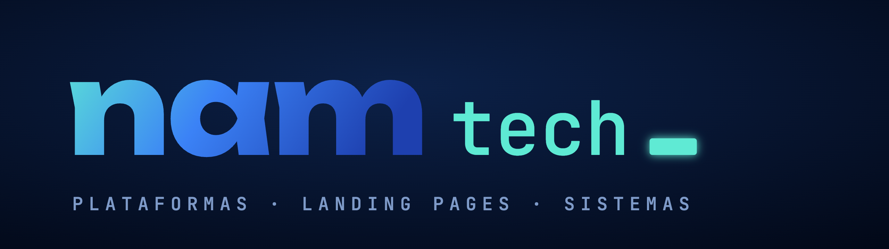
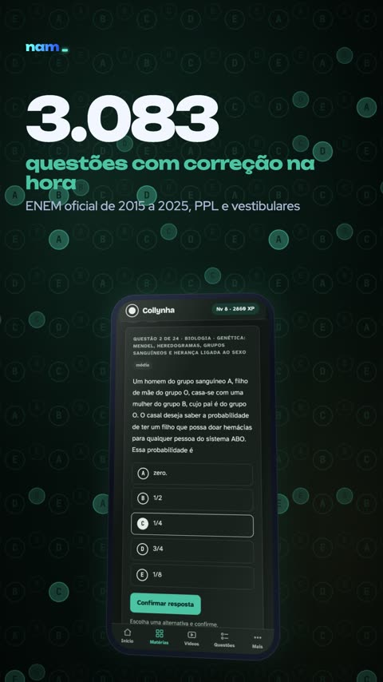
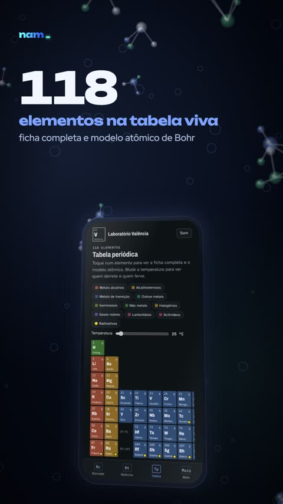
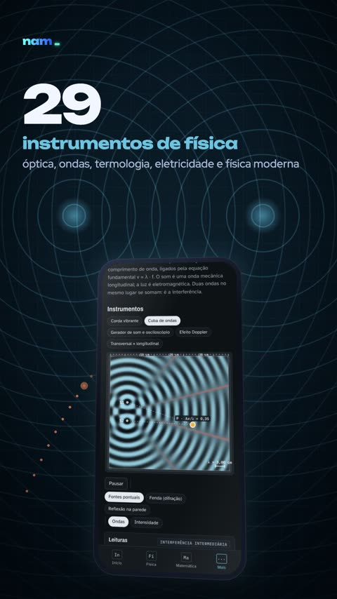
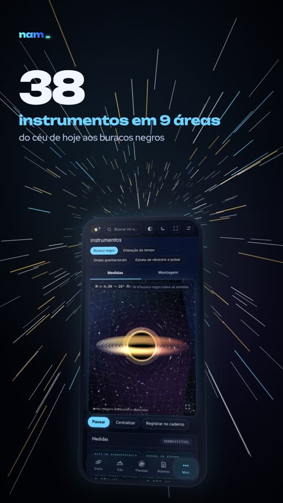
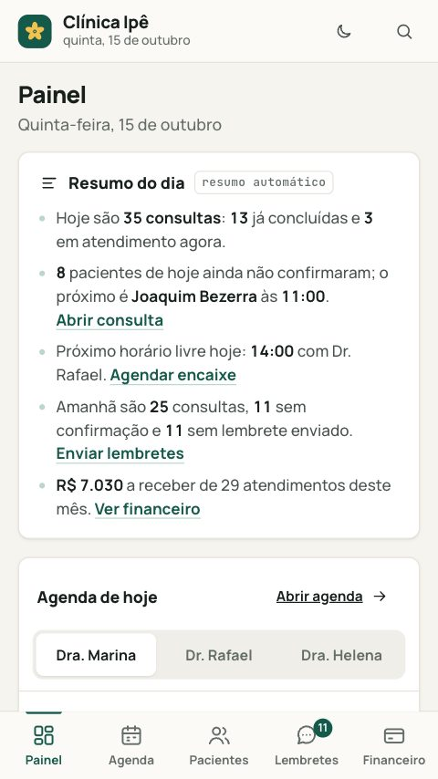

# NAM Tech

Estúdio de design e código de Teresina, Piauí. Páginas únicas, feitas do zero: landing pages, plataformas com
login, experiências interativas e sites com inteligência artificial integrada. Sem template pronto.

> A gente digita cada linha. Seu negócio cresce a cada clique.

## O que fazemos

- **Web design e desenvolvimento web**: landing pages e sites institucionais com identidade própria, responsivos
  e otimizados para desempenho em dispositivos móveis.
- **Gráficos 3D e WebGL**: cenas tridimensionais interativas no navegador, como modelos moleculares, ambientes
  imersivos e vitrines de produtos.
- **Animação e design de interação**: movimento guiado pela rolagem, microinterações e transições que conduzem a
  narrativa da página.
- **Plataformas web**: aplicações com autenticação, área do usuário, banco de dados em nuvem, notificações e
  funcionamento como aplicativo instalável (PWA).
- **Ferramentas educacionais interativas**: simuladores, calculadoras, gráficos em tempo real e laboratórios virtuais.
- **Agentes de inteligência artificial**: agentes especializados em pesquisa, criação, revisão e segurança, com
  memória própria e aprovação humana em cada etapa de aprendizado.
- **Segurança e conformidade**: revisão de segurança antes de cada publicação e políticas de privacidade e termos
  de uso conforme a LGPD.

## No ar

Quatro plataformas educacionais criadas do zero, com mais de 100 instrumentos interativos:

| Projeto | O que é |
|---|---|
| **Collynha** | Preparação para o ENEM: 2.677 questões, 2.997 videoaulas e 425 flashcards |
| **Laboratório Valência** | Química: 118 elementos, 54 reações e 40 moléculas em 3D |
| **Laboratório Euler** | Física e matemática: 54 instrumentos, 217 fórmulas e 50 aulas |
| **[Observatório Sagan](https://sagan.namtech.com.br)** | Astronomia: 38 instrumentos em 9 áreas, aberto ao público |

  
  
  
  

Demonstrações: [landing de confeitaria](https://namtech.com.br/demos/doce-ana/) e
[sistema de clínica](https://namtech.com.br/demos/clinica/) (negócios fictícios, para mostrar o resultado).

  
  

## Código aberto

| Repositório | O que é |
|---|---|
| [agentes](https://github.com/namtechbr/agentes) | Seis agentes de IA para o Claude Code: pesquisa, prompt, crítica, segurança, briefing e carreira |
| [skills](https://github.com/namtechbr/skills) | Skills para o Claude Code: squad criativo, professor de IA agêntica e manutenção de memória |
| [demo-doce-ana](https://github.com/namtechbr/demo-doce-ana) | Código da landing de confeitaria |
| [demo-clinica](https://github.com/namtechbr/demo-clinica) | Código do sistema de clínica |

## Como trabalhamos

Conversa, protótipo, desenvolvimento testado no celular e no computador, e publicação com domínio próprio.
Segurança e privacidade fazem parte do processo: cada projeto passa por uma revisão de segurança antes de
publicar e sai com política de privacidade conforme a LGPD.

## Contato

[namtech.com.br](https://namtech.com.br) · [WhatsApp](https://wa.me/5586998384919) · [Instagram](https://www.instagram.com/namtech_)
